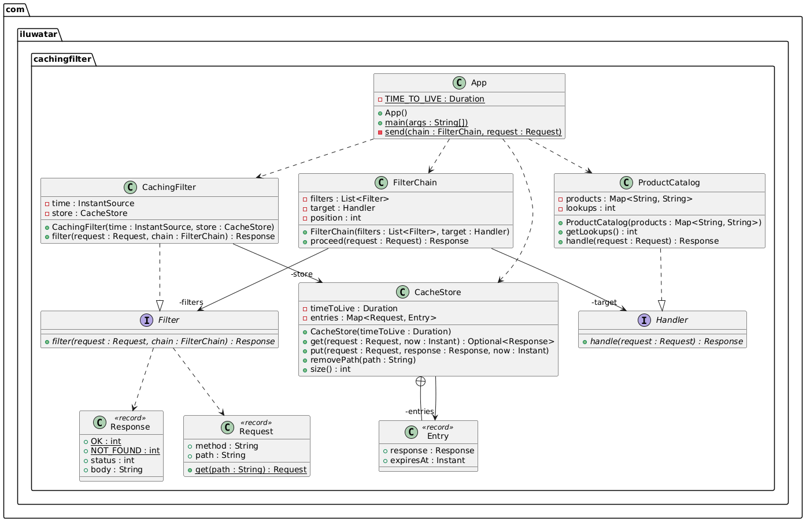
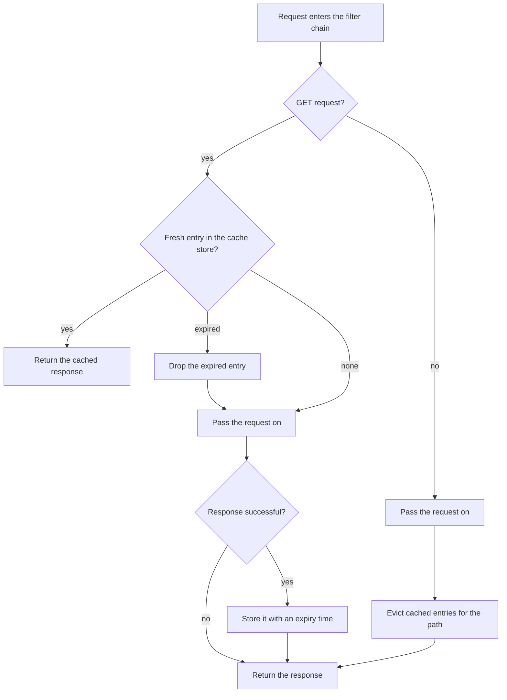

## Also known as

* Response Cache Filter
* Caching Interceptor

## Intent of Caching Filter Design Pattern

Speed up a request-processing pipeline by placing a cache in the filter chain. The filter answers a repeated request with a stored response while that response is still fresh, and only lets the request reach the handler on a miss or after the entry expires. Neither the handler nor the other filters need to know that caching happens.

## Detailed Explanation of Caching Filter Pattern with Real-World Examples

Real-world example

> A shop's information desk gets asked the same questions all day: "How much is the espresso machine?" The first time, the clerk walks to the stock room to check the price tag and writes the answer on a sticky note with the time. When the next customer asks, the clerk reads the note instead of walking back. Once the note is older than half an hour, the clerk throws it away and checks the stock room again, so a price change is never hidden for long.

In plain words

> A caching filter is a filter in front of a handler that remembers recent responses and returns them again until they expire.

Wikipedia says

> A web cache (or HTTP cache) is a system for optimizing the World Wide Web. It is implemented both client-side and server-side. The caching of multimedia and other files can result in less overall delay when browsing the Web.

Class diagram



Flowchart



## Programmatic Example of Caching Filter Pattern in Java

The example puts a `CachingFilter` in front of a slow `ProductCatalog`. It follows the Intercepting Filter structure: a `FilterChain` runs its filters in order and ends in a `Handler`.

**Filter and chain.** A `Filter` either answers a request itself or passes it on with `chain.proceed(request)`. The chain hands the request to the next filter, and to the handler once no filter is left.

```java
public interface Filter {
  Response filter(Request request, FilterChain chain);
}

public final class FilterChain {
  // filters, target handler and the position of the next filter

  public Response proceed(Request request) {
    if (position == filters.size()) {
      return target.handle(request);
    }
    var next = new FilterChain(filters, target, position + 1);
    return filters.get(position).filter(request, next);
  }
}
```

**Cache store.** The `CacheStore` holds the cache entries, keyed by request, and the expiration policy: a response stays valid for a fixed time to live after it is stored. An entry found expired on lookup is dropped, so it is never served again.

```java
public class CacheStore {

  private record Entry(Response response, Instant expiresAt) {}

  private final Duration timeToLive;
  private final Map<Request, Entry> entries = new ConcurrentHashMap<>();

  public Optional<Response> get(Request request, Instant now) {
    var entry = entries.get(request);
    if (entry == null) {
      return Optional.empty();
    }
    if (!now.isBefore(entry.expiresAt())) {
      entries.remove(request, entry);
      return Optional.empty();
    }
    return Optional.of(entry.response());
  }

  public void put(Request request, Response response, Instant now) {
    entries.put(request, new Entry(response, now.plus(timeToLive)));
  }

  public void removePath(String path) {
    entries.keySet().removeIf(request -> request.path().equals(path));
  }
}
```

**Caching filter.** The `CachingFilter` asks the store for a fresh response and returns it without calling the rest of the chain. Otherwise the request goes on, and a successful response is stored. Only `GET` requests are cached. Any other method may change state, so it passes straight through and then evicts the cached entries for its path, and the next `GET` reaches the handler again.

```java
public class CachingFilter implements Filter {

  private final InstantSource time;
  private final CacheStore store;

  @Override
  public Response filter(Request request, FilterChain chain) {
    if (!"GET".equals(request.method())) {
      var response = chain.proceed(request);
      store.removePath(request.path());
      return response;
    }
    var now = time.instant();
    var cached = store.get(request, now);
    if (cached.isPresent()) {
      return cached.get();
    }
    var response = chain.proceed(request);
    if (response.status() == Response.OK) {
      store.put(request, response, now);
    }
    return response;
  }
}
```

The current time comes from a `java.time.InstantSource`. In production a `Clock` such as `Clock.systemUTC()` is passed in; a test or a demo passes a source it can move forward, so expiry can be checked without sleeping.

**Handler.** `ProductCatalog` looks up a product by path and counts its lookups, which shows how many requests the cache saved.

**Putting it together.** `App` builds the chain, sends a few requests, moves time forward by the time to live and sends more.

```java
var now = new AtomicReference<>(Instant.parse("2026-01-01T09:00:00Z"));
var catalog = new ProductCatalog(Map.of(
    "/products/1", "Espresso machine, 199 EUR",
    "/products/2", "Coffee grinder, 89 EUR"));
var chain = new FilterChain(List.of(new CachingFilter(now::get, new CacheStore(TIME_TO_LIVE))), catalog);

send(chain, Request.get("/products/1"));
send(chain, Request.get("/products/1"));
send(chain, Request.get("/products/2"));

now.set(now.get().plus(TIME_TO_LIVE));
send(chain, Request.get("/products/1"));
send(chain, Request.get("/products/1"));
```

The output shows the second request for product 1 served from the cache, and the entry refreshed once it expires:

```
INFO  CachingFilter -- Cache miss for /products/1
INFO  ProductCatalog -- Catalog lookup #1 for /products/1
INFO  App -- GET /products/1 -> 200 Espresso machine, 199 EUR
INFO  CachingFilter -- Cache hit for /products/1
INFO  App -- GET /products/1 -> 200 Espresso machine, 199 EUR
INFO  CachingFilter -- Cache miss for /products/2
INFO  ProductCatalog -- Catalog lookup #2 for /products/2
INFO  App -- GET /products/2 -> 200 Coffee grinder, 89 EUR
INFO  App -- PT30S later
INFO  CacheStore -- Dropping expired entry for /products/1
INFO  CachingFilter -- Cache miss for /products/1
INFO  ProductCatalog -- Catalog lookup #3 for /products/1
INFO  App -- GET /products/1 -> 200 Espresso machine, 199 EUR
INFO  CachingFilter -- Cache hit for /products/1
INFO  App -- GET /products/1 -> 200 Espresso machine, 199 EUR
INFO  App -- Catalog served 3 of 5 requests
```

## When to Use the Caching Filter Pattern in Java

* The same read requests arrive often and producing their responses is slow or costly, such as a database query or a call to another service.
* Slightly stale responses are acceptable for a bounded time.
* Caching should be added to or removed from a request pipeline without changing the handlers behind it.

## Real-World Applications of Caching Filter Pattern in Java

* Servlet filters and Spring `OncePerRequestFilter` implementations that cache rendered pages or REST responses.
* HTTP reverse proxies and CDNs such as Varnish, NGINX `proxy_cache` and Cloudflare, which sit in front of an origin server and honour cache lifetimes.
* OkHttp's `Cache` and Spring Cloud Gateway's local response cache filter, which cache HTTP responses on the client or gateway side.

## Benefits and Trade-offs of Caching Filter Pattern

Benefits:

* Repeated requests are answered quickly and the handler sees less load.
* Caching is a separate concern in its own filter, so handlers stay unaware of it and it can be switched on per pipeline.
* An expiry time bounds how long a response can be stale.

Trade-offs:

* Clients may see stale data until an entry expires; choosing the time to live is a trade-off between freshness and load.
* Evicting on a write only helps writes that pass through the same filter; a change made elsewhere, or by another server instance, stays hidden until the entry expires.
* The cache key must capture everything that changes the response (path, query, user, headers), or one client may get another's response.
* The cache uses memory. Expired entries are dropped only when looked up again, so a real system also needs a size limit or a periodic sweep.
* Each server instance holds its own cache unless a shared cache is used.

## Related Java Design Patterns

* [Intercepting Filter](../intercepting-filter): the caching filter is one filter in an intercepting filter chain.
* [Chain of Responsibility](../chain-of-responsibility): each filter decides whether to answer the request or pass it on.
* [Caching](../caching): the general pattern of keeping resources in fast storage for reuse.
* [Decorator](../decorator): like a decorator, the filter adds caching around a handler without changing it.
* [Proxy](../proxy): a caching proxy stands in front of an object in the same way the filter stands in front of a handler.

## References and Credits

* [Core J2EE Patterns: Best Practices and Design Strategies](https://amzn.to/4cAbDap)
* [Web cache (Wikipedia)](https://en.wikipedia.org/wiki/Web_cache)
* [RFC 9111: HTTP Caching](https://www.rfc-editor.org/rfc/rfc9111)
* [InstantSource (Java SE 21 API)](https://docs.oracle.com/en/java/javase/21/docs/api/java.base/java/time/InstantSource.html)
