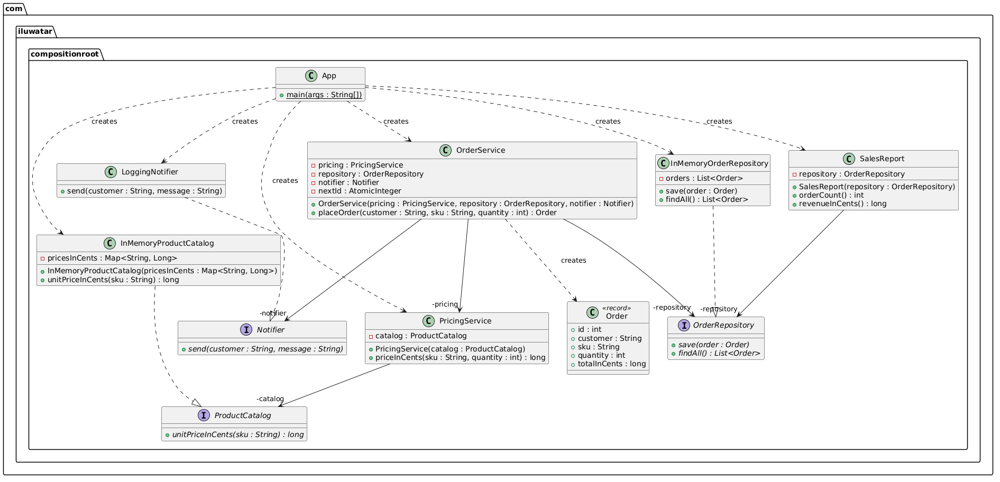

## Also known as

* Object Graph Root
* Pure DI entry point

## Intent of Composition Root Design Pattern

Create and connect all of an application's objects in a single place, as close as possible to its entry point, so that every other class only receives its dependencies and never creates or looks them up.

## Detailed Explanation of Composition Root Pattern with Real-World Examples

Real-world example

> A theatre production has one stage manager who, before the curtain rises, decides which actor plays which role, which technician runs the lights and which prop goes on which table. The actors never hire each other or go shopping for props during the show; they use what was handed to them. To stage a rehearsal with understudies, only the stage manager's casting sheet changes, and the script stays the same.

In plain words

> One method at the start of the program builds every object and plugs them together; all other classes just accept what they are given in their constructors.

Mark Seemann says

> A Composition Root is a (preferably) unique location in an application where modules are composed together.

Class diagram



## Programmatic Example of Composition Root Pattern in Java

The example is a small shop that places orders and reports sales. It shows the two sides of the pattern: classes that only accept dependencies, and the one place that creates them.

**Classes below the root only accept dependencies.** `OrderService` needs a pricing service, a repository and a notifier. It receives all three through its constructor and never calls `new` on any of them, nor asks a container or locator for them.

```java
public class OrderService {

  private final PricingService pricing;
  private final OrderRepository repository;
  private final Notifier notifier;
  private final AtomicInteger nextId = new AtomicInteger(1);

  public OrderService(PricingService pricing, OrderRepository repository, Notifier notifier) {
    this.pricing = pricing;
    this.repository = repository;
    this.notifier = notifier;
  }

  public Order placeOrder(String customer, String sku, int quantity) {
    var total = pricing.priceInCents(sku, quantity);
    var order = new Order(nextId.getAndIncrement(), customer, sku, quantity, total);
    repository.save(order);
    notifier.send(customer, "Order #" + order.id() + " confirmed, total " + total + " cents");
    return order;
  }
}
```

`PricingService` depends on a `ProductCatalog` and `SalesReport` on an `OrderRepository`, in the same way. `ProductCatalog`, `OrderRepository` and `Notifier` are interfaces, so a class never learns which implementation it got. The only objects created below the root are values, such as the `Order` record.

**The composition root creates and connects everything.** `App.main` is the single place where collaborators are instantiated. It builds the leaves first, then the classes that depend on them, and passes each object to its consumers by hand. No DI framework is involved.

```java
@Slf4j
public class App {

  public static void main(String[] args) {
    // Compose the object graph: leaves first, then the classes that depend on them.
    ProductCatalog catalog =
        new InMemoryProductCatalog(Map.of("BOOK-001", 2_500L, "MUG-002", 1_200L));
    OrderRepository repository = new InMemoryOrderRepository();
    Notifier notifier = new LoggingNotifier();
    var pricing = new PricingService(catalog);
    var orderService = new OrderService(pricing, repository, notifier);
    var salesReport = new SalesReport(repository);

    // Use the composed graph.
    orderService.placeOrder("alice", "BOOK-001", 2);
    orderService.placeOrder("bob", "MUG-002", 3);
    LOGGER.info(
        "Placed {} orders, revenue {} cents",
        salesReport.orderCount(),
        salesReport.revenueInCents());
  }
}
```

The root also owns object lifetimes. It creates one `InMemoryOrderRepository` and hands that same instance to both `OrderService` and `SalesReport`, so the report sees the orders the service places. Neither class knows the instance is shared.

Running the example prints:

```
16:32:17.600 [main] INFO com.iluwatar.compositionroot.LoggingNotifier -- To alice: Order #1 confirmed, total 5000 cents
16:32:17.601 [main] INFO com.iluwatar.compositionroot.LoggingNotifier -- To bob: Order #2 confirmed, total 3600 cents
16:32:17.602 [main] INFO com.iluwatar.compositionroot.App -- Placed 2 orders, revenue 8600 cents
```

**Tests are composition roots too.** Because nothing below the root picks its own collaborators, a test can wire the same classes differently. `OrderServiceTest` composes the graph with a notifier that records messages instead of logging them:

```java
@BeforeEach
void compose() {
  var catalog = new InMemoryProductCatalog(Map.of("BOOK-001", 2_500L, "MUG-002", 1_200L));
  repository = new InMemoryOrderRepository();
  Notifier recordingNotifier = (customer, message) -> sentMessages.add(customer + ": " + message);
  orderService = new OrderService(new PricingService(catalog), repository, recordingNotifier);
  salesReport = new SalesReport(repository);
}
```

## When to Use the Composition Root Pattern in Java

* Any application that uses dependency injection, to decide where the injected objects are actually created.
* The object graph should be visible in one place, so a reader can see what implementation each class gets.
* Implementations must be swappable per environment or per test without touching the classes that use them.
* A DI framework is unwanted or unavailable, for example in small services, CLIs, libraries' sample apps or teaching code.

## Real-World Applications of Composition Root Pattern in Java

* The `main` method of a plain Java service that builds its repositories, clients and handlers by hand ("Pure DI").
* Spring's `@Configuration` classes and the `ApplicationContext` built in `SpringApplication.run`, which act as a framework-managed composition root.
* Guice modules passed to `Guice.createInjector` at application start-up.
* Dagger components, which generate the composition root's wiring code at compile time.
* Android's `Application.onCreate`, where many apps build their shared dependencies before any activity starts.

## Benefits and Trade-offs of Composition Root Pattern

Benefits:

* All wiring lives in one place, so the shape of the application is easy to read and change.
* Classes stay free of creation logic and of any dependency on a container or locator, which keeps them simple and reusable.
* Tests compose the same classes with test doubles, with no framework support needed.
* Lifetimes, such as a shared instance versus one per consumer, are decided explicitly by the root.
* Wiring mistakes in Pure DI show up as compile errors, not at runtime.

Trade-offs:

* In large applications the root grows long; it often needs to be split into helper methods or modules, or replaced by a DI framework.
* The root depends on every concrete class, so it changes whenever the graph changes.
* Objects that are needed only on some code paths are still created up front, unless the root passes factories or lazy suppliers.

## Related Java Design Patterns

* [Dependency Injection](../dependency-injection): the composition root is where the injected dependencies are created and passed in.
* [Service Locator](../service-locator): the alternative the composition root avoids; classes pull dependencies from a locator instead of receiving them.
* [Factory](../factory): the root can pass factories to classes that need to create objects later, keeping creation decisions in the root.
* [Abstract Factory](../abstract-factory): groups the creation of related implementations that the root selects and wires.

## References and Credits

* [Composition Root (Mark Seemann)](https://blog.ploeh.dk/2011/07/28/CompositionRoot/)
* [Dependency Injection Principles, Practices, and Patterns (Mark Seemann and Steven van Deursen)](https://www.manning.com/books/dependency-injection-principles-practices-patterns)
* [Pure DI (Mark Seemann)](https://blog.ploeh.dk/2014/06/10/pure-di/)
* [Inversion of Control Containers and the Dependency Injection pattern (Martin Fowler)](https://martinfowler.com/articles/injection.html)
