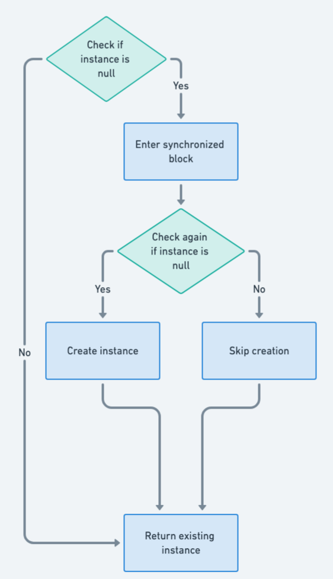

## Intent of Double-Checked Locking Design Pattern

Reduce the overhead of acquiring a lock by first testing the locking criterion (the "lock hint") without actually acquiring the lock. Only if the locking criterion appears to be true does the actual locking logic proceed. Double-checked locking in Java helps in optimizing performance and ensuring thread safety.

## Detailed Explanation of Double-Checked Locking Pattern with Real-World Examples

Real-world example

> In a company with a high-value equipment room, employees first check a visible sign to see if the room is locked. If the sign shows it's unlocked, they enter directly; if locked, they use a security keycard for access. This two-step verification process efficiently manages security without unnecessary use of the electronic lock system, mirroring the Double-Checked Locking pattern used in software to minimize resource-intensive operations.

In plain words

> The Double-Checked Locking pattern in software minimizes costly locking operations by first checking the lock status in a low-cost manner before proceeding with a more resource-intensive lock, ensuring efficiency and thread safety during object initialization.

Wikipedia says

> In software engineering, double-checked locking (also known as "double-checked locking optimization") is a software design pattern used to reduce the overhead of acquiring a lock by testing the locking criterion (the "lock hint") before acquiring the lock. Locking occurs only if the locking criterion check indicates that locking is required.

Flowchart



## Programmatic Example of Double-Checked Locking Pattern in Java

The Double-Checked Locking pattern is used in the `Inventory` class to ensure that no more items than the inventory size are stored, even when `addItem` is called from multiple threads. Here's how it works:

1. Check if the inventory has room (first check): If it does not, return immediately without acquiring the lock.

```java
if (items.size() < inventorySize) {
  // ...
}
```

2. Acquire the lock: This ensures that only one thread at a time proceeds to add an item.

```java
lock.lock();
```

3. Check again if the inventory has room. If another thread has filled the inventory by the time the current thread acquires the lock, the item is not added.

```java
if (items.size() < inventorySize) {
  items.add(item);
}
```

4. Release the lock and return whether the item was added.

```java
lock.unlock();
return true;
```

Here's the complete code for the `Inventory` class:

```java
public class Inventory {

  private final int inventorySize;
  private final List<Item> items;
  private final Lock lock;

  public Inventory(int inventorySize) {
    this.inventorySize = inventorySize;
    this.items = new ArrayList<>(inventorySize);
    this.lock = new ReentrantLock();
  }

  public boolean addItem(Item item) {
    if (items.size() < inventorySize) {
      lock.lock();
      try {
        if (items.size() < inventorySize) {
          items.add(item);
          var thread = Thread.currentThread();
          LOGGER.info("{}: items.size()={}, inventorySize={}", thread, items.size(), inventorySize);
          return true;
        }
      } finally {
        lock.unlock();
      }
    }
    return false;
  }
}
```

In this code, the lock is only acquired when the inventory is not already obviously full, which is the first check. The second check inside the locked section guarantees that the inventory size is never exceeded, even when the `addItem` method is called from multiple threads simultaneously. This is known as double-checked locking.

## When to Use the Double-Checked Locking Pattern in Java

Use the Double-Checked Locking pattern in Java when all the following conditions are met:

* There is a singleton resource that is expensive to create.
* There is a need to reduce the overhead of acquiring a lock every time the resource is accessed.

## Real-World Applications of Double-Checked Locking Pattern in Java

* Singleton pattern implementation in multithreading environments.
* Lazy initialization of resource-intensive objects in Java applications.

## Benefits and Trade-offs of Double-Checked Locking Pattern

Benefits:

* Performance gains from avoiding unnecessary locking after the object is initialized.
* Thread safety is maintained for critical initialization sections.

Trade-offs:

* Complex implementation can lead to mistakes, such as incorrect publishing of objects due to memory visibility issues.
* In Java, it can be redundant or broken in some versions unless volatile variables are used with care.

## Related Java Design Patterns

* [Singleton](https://java-design-patterns.com/patterns/singleton/): Double-Checked Locking is often used in implementing thread-safe Singletons.
* [Lazy Loading](https://java-design-patterns.com/patterns/lazy-loading/): Shares the concept of delaying object creation until necessary.

## References and Credits

* [Java Concurrency in Practice](https://amzn.to/4aIAPKa)
* [Effective Java](https://amzn.to/3xx7KDh)
