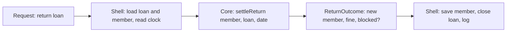
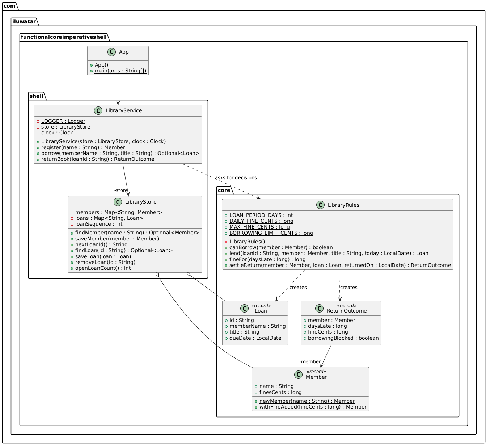

## Also known as

* FCIS
* Functional Core, Imperative Shell Architecture
* Impureim Sandwich

## Intent of Functional Core, Imperative Shell Design Pattern

Split a program into a functional core that holds every business decision as a pure function over immutable values, and a thin imperative shell that performs all side effects (reading input, the clock, persistence, logging) and calls the core to decide what to do.

## Detailed Explanation of Functional Core, Imperative Shell Pattern with Real-World Examples

Real-world example

> A library desk has a rule book and a librarian. The rule book says how long a book may be kept, how much each late day costs and when a member may no longer borrow. It never looks at a calendar or a shelf; you open it with the facts and it tells you the answer. The librarian does everything else: checks today's date, looks up the member's record, stamps the book and writes the new balance into the ledger. Changing the fine only changes the rule book, and anyone can check the rule book with pen and paper, without a librarian or a ledger.

In plain words

> Put the decisions in pure functions that take values and return values, and push everything that touches the outside world into a small layer around them.

Gary Bernhardt, who named the pattern, says

> This functional core is surrounded by a shell of imperative code: it manipulates stdin, stdout, the database, and the network, all based on values produced by the functional core. This design has many nice side effects. For example, testing the functional pieces is very easy, and it often naturally allows isolated testing with no test doubles.

Flowchart



## Programmatic Example of Functional Core, Imperative Shell Pattern in Java

The example runs a small library. Members borrow books for fourteen days; a late book costs 25 cents a day, capped at 500 cents per book, and a member who owes 1000 cents or more may not borrow.

**Functional core.** The domain is a set of immutable records. Changing a member returns a new member.

```java
public record Member(String name, long finesCents) {

  public static Member newMember(String name) {
    return new Member(name, 0);
  }

  public Member withFineAdded(long fineCents) {
    return new Member(name, finesCents + fineCents);
  }
}

public record Loan(String id, String memberName, String title, LocalDate dueDate) {}

public record ReturnOutcome(
    Member member, long daysLate, long fineCents, boolean borrowingBlocked) {}
```

`LibraryRules` holds every rule as a pure function. The current date is a parameter, so the core never reads a clock; it also never loads, saves or logs anything. A decision is returned as a value, here a `ReturnOutcome`.

```java
public final class LibraryRules {

  public static boolean canBorrow(Member member) {
    return member.finesCents() < BORROWING_LIMIT_CENTS;
  }

  public static Loan lend(String loanId, Member member, String title, LocalDate today) {
    if (!canBorrow(member)) {
      throw new IllegalStateException(member.name() + " owes too much to borrow");
    }
    return new Loan(loanId, member.name(), title, today.plusDays(LOAN_PERIOD_DAYS));
  }

  public static long fineFor(long daysLate) {
    return Math.min(Math.max(daysLate, 0) * DAILY_FINE_CENTS, MAX_FINE_CENTS);
  }

  public static ReturnOutcome settleReturn(Member member, Loan loan, LocalDate returnedOn) {
    // reject a loan that belongs to someone else
    var daysLate = Math.max(ChronoUnit.DAYS.between(loan.dueDate(), returnedOn), 0);
    var fine = fineFor(daysLate);
    var updated = member.withFineAdded(fine);
    return new ReturnOutcome(updated, daysLate, fine, !canBorrow(updated));
  }
}
```

Because the core is pure, its tests only build values and compare results. There is nothing to mock.

```java
@Test
void lateReturnAddsFineToNewMemberAndLeavesOriginalUntouched() {
  var outcome = LibraryRules.settleReturn(ALICE, LOAN, DUE.plusDays(4));

  assertEquals(100, outcome.fineCents());
  assertEquals(new Member("alice", 100), outcome.member());
  assertEquals(0, ALICE.finesCents());
}
```

**Imperative shell.** `LibraryStore` stands in for a database: it holds the mutable state and hands out loan ids like a sequence. `LibraryService` is the shell around the core. Each operation follows the same three steps: gather the inputs (load records, read the clock), ask the core for a decision, then carry it out (save, log). The shell contains no business rules of its own.

```java
@Slf4j
@RequiredArgsConstructor
public class LibraryService {

  private final LibraryStore store;
  private final Clock clock;

  public Optional<Loan> borrow(String memberName, String title) {
    var member = loadMember(memberName);
    if (!LibraryRules.canBorrow(member)) {
      LOGGER.info("{} may not borrow '{}': owes {} cents", memberName, title, member.finesCents());
      return Optional.empty();
    }
    var loan = LibraryRules.lend(store.nextLoanId(), member, title, today());
    store.saveLoan(loan);
    LOGGER.info("{} borrowed '{}', due {}", memberName, title, loan.dueDate());
    return Optional.of(loan);
  }

  public ReturnOutcome returnBook(String loanId) {
    var loan = store.findLoan(loanId).orElseThrow(/* ... */);
    var outcome = LibraryRules.settleReturn(loadMember(loan.memberName()), loan, today());
    store.saveMember(outcome.member());
    store.removeLoan(loanId);
    LOGGER.info(/* days late, fine, new balance */);
    return outcome;
  }

  private LocalDate today() {
    return LocalDate.now(clock);
  }
}
```

The shell is covered by integration tests that run the real store and the real core together, with a fixed `Clock` for a repeatable date.

**Putting it together.** `App` wires the shell to a store and the system clock. To show late returns, a second service shares the same store but reads a clock set five weeks ahead.

```java
public static void main(String[] args) {
  var store = new LibraryStore();
  var clock = Clock.systemDefaultZone();
  var library = new LibraryService(store, clock);

  library.register("alice");
  var novel = library.borrow("alice", "The Hobbit").orElseThrow();
  var atlas = library.borrow("alice", "World Atlas").orElseThrow();

  var fiveWeeksLater = new LibraryService(store, Clock.offset(clock, Duration.ofDays(35)));
  fiveWeeksLater.returnBook(novel.id());
  fiveWeeksLater.returnBook(atlas.id());
  fiveWeeksLater.borrow("alice", "Dune");

  LOGGER.info("Open loans left: {}", store.openLoanCount());
}
```

Program output (dates depend on the day it runs):

```
16:34:44.970 [main] INFO com.iluwatar.functionalcoreimperativeshell.shell.LibraryService -- Registered alice
16:34:44.970 [main] INFO com.iluwatar.functionalcoreimperativeshell.shell.LibraryService -- alice borrowed 'The Hobbit', due 2026-12-03
16:34:44.971 [main] INFO com.iluwatar.functionalcoreimperativeshell.shell.LibraryService -- alice borrowed 'World Atlas', due 2026-12-03
16:34:44.971 [main] INFO com.iluwatar.functionalcoreimperativeshell.shell.LibraryService -- alice returned 'The Hobbit' 21 days late, fined 500 cents, now owes 500 cents
16:34:44.971 [main] INFO com.iluwatar.functionalcoreimperativeshell.shell.LibraryService -- alice returned 'World Atlas' 21 days late, fined 500 cents, now owes 1000 cents and may not borrow
16:34:44.971 [main] INFO com.iluwatar.functionalcoreimperativeshell.shell.LibraryService -- alice may not borrow 'Dune': owes 1000 cents
16:34:44.971 [main] INFO com.iluwatar.functionalcoreimperativeshell.App -- Open loans left: 0
```

## Class diagram



## When to Use the Functional Core, Imperative Shell Pattern in Java

* The business rules are worth testing thoroughly, and setting up mocks for the database, clock or network makes those tests slow or brittle.
* Decisions depend on the current time, random values or external data that should be passed in rather than read from inside the logic.
* The same rules must run behind different shells, such as a web controller, a batch job and a command-line tool.
* The application has a clear request, decide, act flow, as most services, command handlers and message consumers do.

## Real-World Applications of Functional Core, Imperative Shell Pattern in Java

* Event-sourced systems where a pure `decide(command, state)` function returns events and the shell stores and publishes them, as in Jérémie Chassaing's Decider pattern for functional event sourcing.
* Redux-style state containers and the Elm Architecture, where a pure reducer computes the next state and the runtime performs the effects.
* Pricing, tax and discount engines that compute a quote from a cart and a price list while the surrounding service loads the data and saves the order.
* Game servers that compute the next world state in a pure update step and leave networking and persistence to the loop around it.

## Benefits and Trade-offs of Functional Core, Imperative Shell Pattern

Benefits:

* The core is tested with plain values, so its tests need no mocks, run fast and fail only when a rule changes.
* Business rules are easy to read and reason about, since a function's result depends only on its arguments.
* Side effects live in one thin layer, which makes it obvious where the program talks to the outside world and easy to swap the database, clock or transport.
* Immutable values can be shared between threads without locking.

Trade-offs:

* The shell must gather every input up front, which is awkward when a decision needs data that is only known after another lookup; the shell may have to call the core more than once.
* Returning new values instead of mutating can allocate more objects and needs care with large data.
* Developers used to service classes that mix rules and I/O need discipline to keep the boundary, since nothing in Java stops a core function from calling a repository.

## Related Java Design Patterns

* [Hexagonal Architecture](../hexagonal-architecture): also keeps the domain apart from I/O, using ports and adapters; the functional core is a domain with no ports at all.
* [Onion Architecture](../onion-architecture): places the domain at the centre with infrastructure outside, which matches the core and shell layers.
* [Value Object](../value-object): the core is built from immutable values like `Member` and `Loan`.
* [Strategy](../strategy): different rule sets can be passed to the shell as pure strategies.
* [Service Layer](../service-layer): the imperative shell plays the role of a thin service layer that only coordinates.

## References and Credits

* [Functional Core, Imperative Shell (Gary Bernhardt, Destroy All Software)](https://www.destroyallsoftware.com/screencasts/catalog/functional-core-imperative-shell)
* [Boundaries (Gary Bernhardt, SCNA 2012)](https://www.destroyallsoftware.com/talks/boundaries)
* [Functional Core Imperative Shell (Kenneth Lange)](https://kennethlange.com/functional-core-imperative-shell/)
* [Building Modern Architectures: Functional Core, Imperative Shell revamp (Albert Llousas)](https://medium.com/@albert.llousas/building-modern-architectures-functional-core-imperative-shell-revamp-0bb5ae62b589)
* [A Look at the Functional Core and Imperative Shell Pattern (SSENSE Tech)](https://medium.com/ssense-tech/a-look-at-the-functional-core-and-imperative-shell-pattern-be2498da153a)
* [Impureim sandwich (Mark Seemann)](https://blog.ploeh.dk/2020/03/02/impureim-sandwich/)
