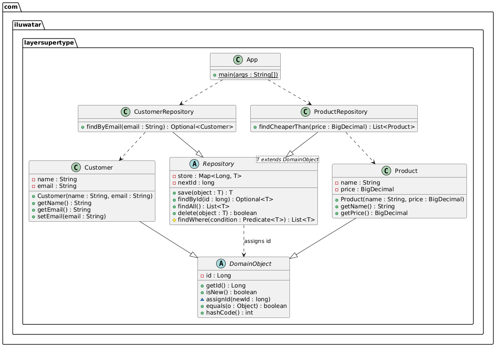

## Also known as

* Base Entity (for the domain layer variant)
* Layer Base Class

## Intent of Layer Supertype Design Pattern

Give every class in one layer a common abstract superclass, so that the behaviour all of them need is written once and the concrete classes contain only what makes them different.

## Detailed Explanation of Layer Supertype Pattern with Real-World Examples

Real-world example

> In a company every employee, whatever their job, gets a staff number, a badge and a payroll record from HR on their first day. Each department then adds its own training on top. Nobody in sales or engineering invents their own way of numbering staff; it comes with being an employee of the company.

In plain words

> When all the classes of a layer repeat the same fields and methods, move them into one base class for that layer and let the classes extend it.

Martin Fowler says

> A type that acts as the supertype for all types in its layer. It's not uncommon for all the objects in a layer to have methods you don't want to have duplicated throughout the system. You can move all of this behavior into a common Layer Supertype.

Class diagram



## Programmatic Example of Layer Supertype Pattern in Java

The example is a small shop with customers and products. It has two layers, and each layer has its own supertype.

**Domain layer supertype.** Every domain object needs an identity. `DomainObject` owns the id, tells whether the object has been saved yet, and defines equality by type and id. The id can be assigned only once, and only from inside the package, so client code cannot change it.

```java
@Getter
@ToString
public abstract class DomainObject {

  private Long id;

  public boolean isNew() {
    return id == null;
  }

  void assignId(long newId) {
    if (id != null) {
      throw new IllegalStateException("Id already assigned: " + id);
    }
    id = newId;
  }

  @Override
  public final boolean equals(Object o) {
    if (this == o) {
      return true;
    }
    if (o == null || getClass() != o.getClass()) {
      return false;
    }
    var other = (DomainObject) o;
    return id != null && id.equals(other.id);
  }

  @Override
  public final int hashCode() {
    return getClass().hashCode();
  }
}
```

The hash code depends only on the type, so it stays the same when an object is saved and gets its id. An object put into a `HashSet` before it is saved can still be found afterwards. `equals` and `hashCode` are `final`, so a subclass cannot quietly replace the identity rules of the layer.

The concrete domain objects hold only their own data:

```java
@Getter
@ToString(callSuper = true)
public class Customer extends DomainObject {

  private final String name;
  @Setter private String email;

  public Customer(String name, String email) {
    this.name = name;
    this.email = email;
  }
}
```

`Product` looks the same, with a name and a price.

**Data access layer supertype.** Every repository needs to hand out ids and to save, find and delete objects. `Repository` does this once for any `DomainObject`. It refuses an object whose id it never handed out, so two repositories cannot give out the same id. It also offers `findWhere` as a building block for type-specific queries.

```java
public abstract class Repository<T extends DomainObject> {

  private final Map<Long, T> store = new LinkedHashMap<>();
  private long nextId = 1;

  public T save(T object) {
    if (object.isNew()) {
      object.assignId(nextId++);
    } else if (!store.containsKey(object.getId())) {
      throw new IllegalArgumentException("Not managed by this repository: " + object.getId());
    }
    store.put(object.getId(), object);
    return object;
  }

  public Optional<T> findById(long id) {
    return Optional.ofNullable(store.get(id));
  }

  public List<T> findAll() {
    return new ArrayList<>(store.values());
  }

  public boolean delete(T object) {
    return !object.isNew() && store.remove(object.getId()) != null;
  }

  protected List<T> findWhere(Predicate<T> condition) {
    return store.values().stream().filter(condition).toList();
  }
}
```

A concrete repository adds only its own queries:

```java
public class CustomerRepository extends Repository<Customer> {

  public Optional<Customer> findByEmail(String email) {
    return findWhere(customer -> customer.getEmail().equalsIgnoreCase(email)).stream().findFirst();
  }
}
```

`ProductRepository` adds `findCheaperThan(BigDecimal)` in the same way.

**Putting it together.** The `App` saves a few objects and uses both the inherited and the specific operations:

```java
public static void main(String[] args) {
  var customers = new CustomerRepository();
  var products = new ProductRepository();

  customers.save(new Customer("Alice", "alice@example.com"));
  var bob = customers.save(new Customer("Bob", "bob@example.com"));
  products.save(new Product("Keyboard", new BigDecimal("49.90")));
  products.save(new Product("Monitor", new BigDecimal("199.00")));
  products.save(new Product("Mouse", new BigDecimal("19.90")));

  LOGGER.info("Customers: {}", customers.findAll());
  LOGGER.info("Products: {}", products.findAll());

  LOGGER.info(
      "Customer with email bob@example.com: {}", customers.findByEmail("BOB@example.com"));
  LOGGER.info("Products cheaper than 50: {}", products.findCheaperThan(new BigDecimal("50")));

  var carol = new Customer("Carol", "carol@example.com");
  var newsletter = new HashSet<Customer>();
  newsletter.add(carol);
  customers.save(carol);
  LOGGER.info(
      "Carol is still found in the newsletter set after saving gave her id {}: {}",
      carol.getId(),
      newsletter.contains(carol));

  var unsaved = new Customer("Bob", "bob@example.com");
  LOGGER.info("An unsaved copy of Bob equals Bob: {}", unsaved.equals(bob));

  customers.delete(bob);
  LOGGER.info("Customers after deleting Bob: {}", customers.findAll());
}
```

Program output:

```
INFO com.iluwatar.layersupertype.App -- Customers: [Customer(super=DomainObject(id=1), name=Alice, email=alice@example.com), Customer(super=DomainObject(id=2), name=Bob, email=bob@example.com)]
INFO com.iluwatar.layersupertype.App -- Products: [Product(super=DomainObject(id=1), name=Keyboard, price=49.90), Product(super=DomainObject(id=2), name=Monitor, price=199.00), Product(super=DomainObject(id=3), name=Mouse, price=19.90)]
INFO com.iluwatar.layersupertype.App -- Customer with email bob@example.com: Optional[Customer(super=DomainObject(id=2), name=Bob, email=bob@example.com)]
INFO com.iluwatar.layersupertype.App -- Products cheaper than 50: [Product(super=DomainObject(id=1), name=Keyboard, price=49.90), Product(super=DomainObject(id=3), name=Mouse, price=19.90)]
INFO com.iluwatar.layersupertype.App -- Carol is still found in the newsletter set after saving gave her id 3: true
INFO com.iluwatar.layersupertype.App -- An unsaved copy of Bob equals Bob: false
INFO com.iluwatar.layersupertype.App -- Customers after deleting Bob: [Customer(super=DomainObject(id=1), name=Alice, email=alice@example.com), Customer(super=DomainObject(id=3), name=Carol, email=carol@example.com)]
```

Customers and products each get their own id sequence, but a customer and a product with the same id are never equal, because equality also compares the type. Carol is put into a `HashSet` before she is saved. Saving gives her an id, but her hash code depends only on her type, so the set still finds her in the same bucket; a hash code built from the id would have moved her and the lookup would fail. An unsaved copy of Bob is not Bob, because an object without an id is equal only to itself.

## When to Use the Layer Supertype Pattern in Java

* Several classes in the same layer repeat the same fields or methods, such as an id, audit fields, validation or logging.
* The layer has rules that must hold for every class in it, for example how identity and equality work for entities.
* The common behaviour is stable enough that putting it in a superclass will not force frequent changes on every subclass.

## Real-World Applications of Layer Supertype Pattern in Java

* Spring Data JPA's `AbstractPersistable` and `AbstractAuditable` are base entities that hold the id and the audit fields.
* Spring Data's `CrudRepository` and `JpaRepository` give every repository the same basic operations, with the concrete interface adding only its own queries.
* Spring MVC applications often have a base controller or a base service class with shared error handling and logging.
* Many JPA projects define a `@MappedSuperclass` `BaseEntity` with id, version and creation and update timestamps.

## Benefits and Trade-offs of Layer Supertype Pattern

Benefits:

* Code that every class of a layer needs is written and tested once.
* Rules of the layer, such as identity and equality, are the same for every class in it.
* Adding a new class to the layer is quick, since it starts with the shared behaviour.

Trade-offs:

* It uses inheritance, and Java allows only one superclass, so a class that already extends something else cannot use it.
* A change to the supertype affects every class in the layer.
* The supertype can grow into a dumping ground for code that only some of the subclasses need. Keep in it only what really belongs to all of them.

## Related Java Design Patterns

* [Domain Model](../domain-model): the domain objects of a domain model often share a layer supertype for identity.
* [Repository](../repository): repositories commonly share a base class or interface with the basic data access operations.
* [Data Mapper](../data-mapper): mappers of one data source often extend a common mapper supertype.
* [Template Method](../template-method): a layer supertype often uses template methods to let subclasses fill in the specific steps.
* [Layered Architecture](../layered-architecture): defines the layers that each get their own supertype.

## References and Credits

* [Layer Supertype (Martin Fowler)](https://martinfowler.com/eaaCatalog/layerSupertype.html)
* [Patterns of Enterprise Application Architecture](https://amzn.to/3WfKBPR)
* [Layer Supertype Pattern (Prashant Brall)](https://prashantbrall.wordpress.com/2011/10/25/layer-supertype-pattern/)
