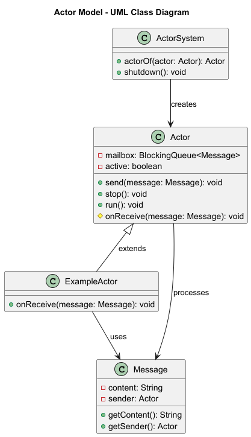

## Còn được gọi là

- Message-passing concurrency (đồng thời dựa trên truyền message)
- Actor-based concurrency (đồng thời dựa trên actor)

---

## Mục đích của mẫu Actor Model

Mẫu Actor Model cho phép xây dựng các hệ thống có tính đồng thời cao, phân tán và chịu lỗi tốt, bằng cách sử dụng các thành phần độc lập (actor) chỉ tương tác với nhau thông qua việc truyền message bất đồng bộ.

---

## Giải thích chi tiết mẫu Actor Model qua các ví dụ thực tế

### 📦 Ví dụ thực tế

Hãy tưởng tượng một hệ thống chăm sóc khách hàng:
- Mỗi **nhân viên hỗ trợ khách hàng** là một **actor**.
- Khách hàng **gửi câu hỏi (message)** đến các nhân viên.
- Mỗi nhân viên xử lý từng yêu cầu một và có thể **phản hồi bất đồng bộ** mà không ảnh hưởng đến các nhân viên khác.

---

### 🧠 Nói đơn giản hơn

> "Actor giống như những người làm việc độc lập, không bao giờ dùng chung bộ nhớ và chỉ giao tiếp với nhau thông qua message."

---

### 📖 Theo Wikipedia

> [Actor model](https://en.wikipedia.org/wiki/Actor_model) là một mô hình toán học về tính toán đồng thời, trong đó "actor" được xem là đơn vị nguyên thủy phổ quát của tính toán đồng thời.

---

### 🧹 Sơ đồ kiến trúc



---

## Ví dụ lập trình mẫu Actor Model trong Java

### Actor.java

```java
public abstract class Actor implements Runnable {

    @Setter @Getter private String actorId;
    private final BlockingQueue<Message> mailbox = new LinkedBlockingQueue<>();
    private volatile boolean active = true; 


    public void send(Message message) {
        mailbox.add(message); 
    }

    public void stop() {
        active = false; 
    }

    @Override
    public void run() {
        
    }

    protected abstract void onReceive(Message message);
}

```

### Message.java

```java

@AllArgsConstructor
@Getter
@Setter
public class Message {
    private final String content;
    private final String senderId;
}
```

### ActorSystem.java

```java
public class ActorSystem {
    public void startActor(Actor actor) {
        String actorId = "actor-" + idCounter.incrementAndGet(); // Generate a new and unique ID
        actor.setActorId(actorId); // assign the actor it's ID
        actorRegister.put(actorId, actor); // Register and save the actor with it's ID
        executor.submit(actor); // Run the actor in a thread
    }
    public Actor getActorById(String actorId) {
        return actorRegister.get(actorId); //  Find by Id
    }

    public void shutdown() {
        executor.shutdownNow(); // Stop all threads
    }
}
```

### App.java

```java
public class App {
  public static void main(String[] args) {
    ActorSystem system = new ActorSystem();
      Actor srijan = new ExampleActor(system);
      Actor ansh = new ExampleActor2(system);

      system.startActor(srijan);
      system.startActor(ansh);
      ansh.send(new Message("Hello ansh", srijan.getActorId()));
      srijan.send(new Message("Hello srijan!", ansh.getActorId()));

      Thread.sleep(1000); // Give time for messages to process

      srijan.stop(); // Stop the actor gracefully
      ansh.stop();
      system.shutdown(); // Stop the actor system
  }
}
```

---

## Khi nào nên sử dụng mẫu Actor Model trong Java

- Khi xây dựng **các hệ thống đồng thời hoặc phân tán**
- Khi bạn muốn **không có trạng thái có thể thay đổi được chia sẻ (shared mutable state)**
- Khi bạn cần **giao tiếp bất đồng bộ, hướng message**
- Khi các thành phần cần được **cô lập và liên kết lỏng lẻo (loosely coupled)**

---

## Các hướng dẫn Java về mẫu Actor Model

- [Baeldung – Akka with Java](https://www.baeldung.com/java-akka)
- [Vaughn Vernon – Reactive Messaging Patterns](https://vaughnvernon.co/?p=1143)

---

## Ứng dụng thực tế của mẫu Actor Model trong Java

- [Akka Framework](https://akka.io/)
- [Cơ chế đồng thời của Erlang và Elixir](https://www.erlang.org/)
- [Microsoft Orleans](https://learn.microsoft.com/en-us/dotnet/orleans/)
- Các game engine và trình mô phỏng chạy trên JVM

---

## Lợi ích và đánh đổi của mẫu Actor Model

### ✅ Lợi ích
- Hỗ trợ tính đồng thời cao
- Dễ dàng mở rộng trên nhiều thread hoặc nhiều máy
- Cô lập lỗi và khả năng phục hồi
- Thứ tự message được giữ nguyên trong từng actor

### ⚠️ Đánh đổi
- Khó debug hơn do hành vi bất đồng bộ
- Tốn thêm một chút hiệu năng do sử dụng hàng đợi message
- Thiết kế phức tạp hơn so với các lời gọi phương thức đơn giản

---

## Các mẫu thiết kế Java liên quan

- [Command Pattern](../../../command)
- [Mediator Pattern](../../../mediator)
- [Event-Driven Architecture](../../../event-driven-architecture)
- [Observer Pattern](../../../observer)

---

## Tài liệu tham khảo và ghi nhận

- *Programming Erlang*, Joe Armstrong
- *Reactive Design Patterns*, Roland Kuhn
- *The Actor Model in 10 Minutes*, [Bài viết trên InfoQ](https://www.infoq.com/articles/actor-model/)
- [Akka Documentation](https://doc.akka.io/docs/akka/current/index.html)
