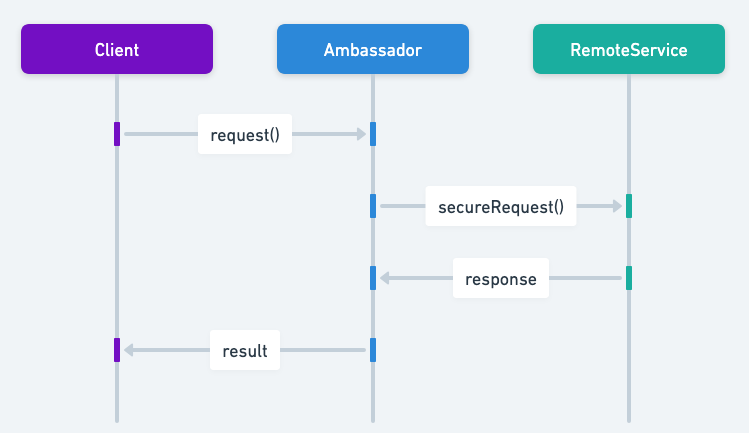

## Mục đích của mẫu thiết kế Ambassador

Mẫu Ambassador trong Java giúp chuyển giao các chức năng chung như giám sát (monitoring), ghi log và định tuyến (routing) từ một tài nguyên dùng chung sang một instance service hỗ trợ, qua đó nâng cao hiệu năng và khả năng bảo trì trong các hệ thống phân tán.

## Giải thích chi tiết mẫu Ambassador kèm ví dụ thực tế

Ví dụ thực tế

> Hãy tưởng tượng một khách sạn đông khách, nơi khách thường xuyên yêu cầu đặt bàn nhà hàng, vé sự kiện hoặc sắp xếp phương tiện đi lại. Thay vì để từng vị khách tự liên hệ với các dịch vụ này, khách sạn bố trí một nhân viên hỗ trợ (concierge). Người concierge thay mặt khách xử lý những việc này, đảm bảo bàn được đặt suôn sẻ, vé được mua kịp thời và phương tiện đi lại được sắp xếp hiệu quả.
>
> Trong phép so sánh này, khách là các client service, các nhà cung cấp bên ngoài (nhà hàng, đơn vị bán vé, dịch vụ vận chuyển) là các remote service, còn người concierge đại diện cho ambassador service. Cách tổ chức này giúp khách tập trung tận hưởng kỳ nghỉ, trong khi concierge lo liệu sự phức tạp của các tương tác bên ngoài, mang lại trải nghiệm liền mạch và tốt hơn.

Nói đơn giản hơn

> Với mẫu Ambassador, chúng ta có thể giảm tần suất polling từ phía client, đồng thời bổ sung việc kiểm tra độ trễ (latency) và ghi log.

Tài liệu của Microsoft viết (tạm dịch)

> Một ambassador service có thể được xem như một proxy chạy ngoài tiến trình (out-of-process) và được đặt cùng chỗ với client. Mẫu này hữu ích để chuyển giao các tác vụ kết nối chung của client như giám sát, ghi log, định tuyến, bảo mật (chẳng hạn TLS) và các mẫu resilience theo cách không phụ thuộc vào ngôn ngữ lập trình. Nó thường được dùng với các ứng dụng cũ (legacy), hoặc các ứng dụng khó sửa đổi, nhằm mở rộng khả năng kết nối mạng của chúng. Nó cũng cho phép một đội chuyên trách triển khai các tính năng đó.

Sơ đồ tuần tự



## Ví dụ lập trình mẫu Ambassador trong Java

Trong ví dụ về mẫu Ambassador trong Java này, chúng ta sẽ minh họa cách triển khai việc kiểm tra độ trễ, ghi log và cơ chế thử lại (retry) để cải thiện độ tin cậy của hệ thống.

Một remote service có nhiều client truy cập vào một chức năng mà nó cung cấp. Service này là một ứng dụng legacy và không thể cập nhật được. Số lượng lớn yêu cầu từ người dùng đang gây ra các vấn đề về kết nối. Cần áp dụng các quy định mới về tần suất gửi yêu cầu, cùng với việc kiểm tra độ trễ và ghi log phía client.

Với phần giới thiệu trên, chúng ta sẽ mô phỏng chức năng này trong ví dụ. Chúng ta có một interface được cả remote service lẫn ambassador service triển khai.

```java
interface RemoteServiceInterface {
    long doRemoteFunction(int value) throws Exception;
}
```

Một remote service được biểu diễn dưới dạng singleton.

```java

@Slf4j
public class RemoteService implements RemoteServiceInterface {
    private static RemoteService service = null;

    static synchronized RemoteService getRemoteService() {
        if (service == null) {
            service = new RemoteService();
        }
        return service;
    }

    private RemoteService() {
    }

    @Override
    public long doRemoteFunction(int value) {
        long waitTime = (long) Math.floor(Math.random() * 1000);

        try {
            sleep(waitTime);
        } catch (InterruptedException e) {
            LOGGER.error("Thread sleep interrupted", e);
        }

        return waitTime >= 200 ? value * 10 : -1;
    }
}
```

Một service ambassador bổ sung các tính năng khác như ghi log và kiểm tra độ trễ.

```java

@Slf4j
public class ServiceAmbassador implements RemoteServiceInterface {
    private static final int RETRIES = 3;
    private static final int DELAY_MS = 3000;

    ServiceAmbassador() {
    }

    @Override
    public long doRemoteFunction(int value) {
        return safeCall(value);
    }

    private long checkLatency(int value) {
        var startTime = System.currentTimeMillis();
        var result = RemoteService.getRemoteService().doRemoteFunction(value);
        var timeTaken = System.currentTimeMillis() - startTime;

        LOGGER.info("Time taken (ms): " + timeTaken);
        return result;
    }

    private long safeCall(int value) {
        var retries = 0;
        var result = (long) FAILURE;

        for (int i = 0; i < RETRIES; i++) {
            if (retries >= RETRIES) {
                return FAILURE;
            }

            if ((result = checkLatency(value)) == FAILURE) {
                LOGGER.info("Failed to reach remote: (" + (i + 1) + ")");
                retries++;
                try {
                    sleep(DELAY_MS);
                } catch (InterruptedException e) {
                    LOGGER.error("Thread sleep state interrupted", e);
                }
            } else {
                break;
            }
        }
        return result;
    }
}
```

Mỗi client có một service ambassador cục bộ dùng để tương tác với remote service.

```java

@Slf4j
public class Client {
    private final ServiceAmbassador serviceAmbassador = new ServiceAmbassador();

    long useService(int value) {
        var result = serviceAmbassador.doRemoteFunction(value);
        LOGGER.info("Service result: " + result);
        return result;
    }
}
```

Dưới đây là hai client sử dụng service.

```java
public class App {
    public static void main(String[] args) {
        var host1 = new Client();
        var host2 = new Client();
        host1.useService(12);
        host2.useService(73);
    }
}
```

Đây là kết quả khi chạy ví dụ:

```java
Time taken(ms):111
Service result:120
Time taken(ms):931
Failed to reach remote:(1)
Time taken(ms):665
Failed to reach remote:(2)
Time taken(ms):538
Failed to reach remote:(3)
Service result:-1
```

## Khi nào nên dùng mẫu Ambassador trong Java

* Mẫu Ambassador đặc biệt hữu ích cho các kiến trúc Cloud Native và Microservices trong Java. Nó hỗ trợ giám sát, ghi log và bảo mật giao tiếp giữa các service, nên rất phù hợp cho các hệ thống phân tán.
* Tích hợp hệ thống legacy: Hỗ trợ giao tiếp với các service mới hơn bằng cách xử lý những chức năng cần thiết nhưng không thuộc phần cốt lõi.
* Cải thiện hiệu năng: Có thể dùng để cache kết quả hoặc nén dữ liệu nhằm tăng hiệu quả giao tiếp.

Các trường hợp sử dụng điển hình gồm:

* Kiểm soát quyền truy cập vào một đối tượng khác
* Triển khai ghi log
* Triển khai circuit breaking
* Chuyển giao các tác vụ của remote service
* Hỗ trợ kết nối mạng

## Lợi ích và đánh đổi của mẫu Ambassador

Lợi ích:

* Tách biệt mối quan tâm (Separation of Concerns): Chuyển các mối quan tâm xuyên suốt (cross-cutting concerns) ra khỏi logic của service, giúp mã nguồn gọn gàng và dễ bảo trì hơn.
* Tái sử dụng logic hạ tầng: Mẫu ambassador cho phép tái sử dụng cùng một logic (ví dụ: ghi log, giám sát) cho nhiều service.
* Tăng cường bảo mật: Tập trung các tính năng bảo mật như SSL termination hay xác thực vào một chỗ, giảm nguy cơ cấu hình sai.
* Linh hoạt: Giúp cập nhật hoặc thay thế các thành phần hạ tầng dễ dàng hơn mà không phải sửa mã nguồn của service.

Đánh đổi:

* Tăng độ phức tạp: Thêm một tầng nữa vào kiến trúc, có thể làm việc thiết kế hệ thống và debug trở nên phức tạp hơn.
* Có thể ảnh hưởng hiệu năng: Bước nhảy mạng (network hop) bổ sung có thể gây thêm độ trễ và chi phí xử lý, đặc biệt khi chưa được tối ưu.
* Chi phí triển khai: Cần thêm tài nguyên và công sức quản lý để triển khai và mở rộng các ambassador service.

## Ứng dụng thực tế của mẫu Ambassador trong Java

* Triển khai Service Mesh: Trong kiến trúc service mesh như Istio hay Linkerd, mẫu Ambassador thường được dùng dưới dạng sidecar proxy để xử lý giao tiếp giữa các service. Điều này bao gồm các tác vụ như service discovery, định tuyến, cân bằng tải (load balancing), telemetry (metrics và tracing) và bảo mật (xác thực và phân quyền).
* API Gateway: API gateway có thể dùng mẫu Ambassador để đóng gói các chức năng chung như giới hạn tần suất (rate limiting), cache, định hình yêu cầu (request shaping) và xác thực. Nhờ đó các backend service có thể tập trung vào logic nghiệp vụ cốt lõi mà không bị đè nặng bởi các mối quan tâm xuyên suốt này.
* Ghi log và giám sát: Một Ambassador có thể tổng hợp log và metrics từ nhiều service rồi chuyển tiếp chúng tới các công cụ giám sát tập trung như Prometheus hoặc ELK Stack (Elasticsearch, Logstash, Kibana). Điều này đơn giản hóa việc thiết lập ghi log và giám sát cho từng service, đồng thời cung cấp một cái nhìn thống nhất về tình trạng của hệ thống.
* Bảo mật: Các chức năng liên quan đến bảo mật như SSL/TLS termination, xác minh danh tính và mã hóa có thể được một Ambassador quản lý. Điều này đảm bảo các service áp dụng thực hành bảo mật nhất quán và giảm khả năng xảy ra sự cố bảo mật do cấu hình sai.
* Khả năng phục hồi (resilience): Ambassador có thể triển khai các mẫu resilience như circuit breaker, retry và timeout. Ví dụ, thư viện Hystrix của Netflix có thể được dùng bên trong một Ambassador để ngăn lỗi lan truyền dây chuyền (cascading failures) trong hệ sinh thái microservices.
* Database Proxy: Ambassador có thể đóng vai trò proxy cho các kết nối cơ sở dữ liệu, cung cấp các chức năng như connection pooling, tách đọc/ghi cho các bản sao (replica) và cache truy vấn. Điều này giảm bớt đáng kể độ phức tạp cho các service ứng dụng.
* Tích hợp hệ thống legacy: Trong các tình huống microservices hiện đại cần giao tiếp với hệ thống legacy, một Ambassador có thể làm trung gian để chuyển đổi giao thức, xử lý các phép biến đổi cần thiết và áp dụng các thực hành bảo mật hiện đại, giúp quá trình tích hợp dễ dàng hơn.
* Tối ưu mạng: Với các service được triển khai ở nhiều vị trí địa lý hoặc nhiều region đám mây khác nhau, Ambassador có thể tối ưu giao tiếp bằng cách nén dữ liệu, gom nhóm yêu cầu (batching), hoặc thậm chí định tuyến thông minh để giảm độ trễ và chi phí.
* [Kubernetes-native API gateway for microservices](https://github.com/datawire/ambassador)

## Các mẫu thiết kế Java liên quan

* [Circuit Breaker](https://java-design-patterns.com/patterns/circuit-breaker/): Thường được dùng kết hợp để quản lý khả năng chịu lỗi bằng cách ngừng gọi tới một service không phản hồi.
* [Decorator](https://java-design-patterns.com/patterns/decorator/): Mẫu decorator dùng để thêm chức năng cho một đối tượng một cách động, trong khi mẫu ambassador dùng để chuyển giao chức năng sang một đối tượng riêng biệt.
* [Proxy](https://java-design-patterns.com/patterns/proxy/): Có nhiều điểm tương đồng với mẫu proxy, nhưng mẫu ambassador tập trung cụ thể vào việc chuyển giao các chức năng phụ trợ.
* Sidecar: Một mẫu tương tự được dùng trong bối cảnh ứng dụng chạy trên container, trong đó một sidecar container cung cấp thêm chức năng cho container ứng dụng chính.

## Tài liệu tham khảo và ghi công

* [Building Microservices: Designing Fine-Grained Systems](https://amzn.to/43aGpSR)
* [Cloud Native Patterns: Designing Change-tolerant Software](https://amzn.to/3wUAl4O)
* [Designing Distributed Systems: Patterns and Paradigms for Scalable, Reliable Services](https://amzn.to/3T9g9Uj)
* [Microservices Patterns: With examples in Java](https://amzn.to/3UyWD5O)
* [Ambassador pattern (Microsoft)](https://docs.microsoft.com/en-us/azure/architecture/patterns/ambassador)
