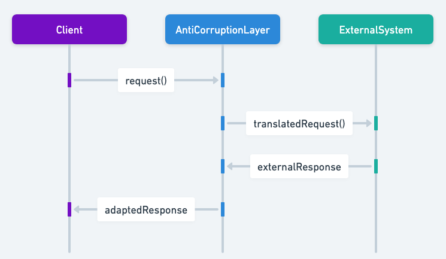

## Còn được gọi là

* ACL
* Interface layer (lớp giao diện)
* Translation layer (lớp chuyển đổi)

## Mục đích của mẫu thiết kế Anti-Corruption Layer

Anti-Corruption Layer (ACL) là một mẫu thiết kế quan trọng trong phát triển Java, đặc biệt trong việc tích hợp hệ thống và duy trì tính toàn vẹn của dữ liệu. Mẫu này triển khai một lớp façade hoặc adapter giữa các subsystem không có cùng ngữ nghĩa. Nó chuyển đổi giữa các định dạng dữ liệu và các hệ thống khác nhau, đảm bảo rằng việc tích hợp giữa các hệ thống không làm sai lệch business logic hay tính toàn vẹn của dữ liệu.

## Giải thích chi tiết mẫu Anti-Corruption Layer kèm ví dụ thực tế

Ví dụ thực tế

> Ví dụ này cho thấy cách Anti-Corruption Layer đảm bảo việc tích hợp liền mạch giữa hệ thống legacy và các nền tảng hiện đại, điều rất quan trọng để giữ vững tính toàn vẹn của business logic trong quá trình chuyển đổi hệ thống.
> 
> Hãy tưởng tượng một công ty bán lẻ lớn đang chuyển hệ thống quản lý kho hàng từ một phần mềm legacy sang một nền tảng mới hiện đại. Hệ thống legacy đã được sử dụng hàng chục năm và chứa các quy tắc nghiệp vụ phức tạp cùng các định dạng dữ liệu không tương thích với hệ thống mới. Thay vì kết nối trực tiếp hệ thống mới với hệ thống legacy, công ty triển khai một Anti-Corruption Layer (ACL).
> 
> ACL đóng vai trò trung gian, chuyển đổi và điều chỉnh dữ liệu giữa hai hệ thống. Khi hệ thống mới yêu cầu dữ liệu kho hàng, ACL chuyển yêu cầu sang định dạng mà hệ thống legacy hiểu được, lấy dữ liệu về, rồi chuyển ngược lại sang định dạng phù hợp với hệ thống mới. Cách tiếp cận này giúp hệ thống mới không bị ảnh hưởng bởi những phức tạp của hệ thống legacy, ngăn dữ liệu và business logic bị sai lệch, đồng thời giúp quá trình chuyển đổi diễn ra suôn sẻ.

Nói đơn giản

> Mẫu thiết kế Anti-Corruption Layer bảo vệ một hệ thống khỏi sự phức tạp và những thay đổi của các hệ thống bên ngoài bằng cách cung cấp một lớp chuyển đổi trung gian.

[Tài liệu của Microsoft](https://learn.microsoft.com/en-us/azure/architecture/patterns/anti-corruption-layer) viết (tạm dịch)

> Triển khai một lớp façade hoặc adapter giữa các subsystem không có cùng ngữ nghĩa. Lớp này chuyển đổi các yêu cầu mà một subsystem gửi tới subsystem kia. Sử dụng mẫu này để đảm bảo thiết kế của ứng dụng không bị giới hạn bởi các phụ thuộc vào subsystem bên ngoài. Mẫu này được Eric Evans mô tả lần đầu trong cuốn Domain-Driven Design.

Sơ đồ tuần tự



## Ví dụ lập trình mẫu Anti-Corruption Layer trong Java

Mẫu thiết kế ACL trong Java cung cấp một lớp trung gian chuyển đổi các định dạng dữ liệu, đảm bảo rằng việc tích hợp giữa các hệ thống khác nhau không dẫn đến sai lệch dữ liệu.

Dưới đây là 2 hệ thống đặt hàng của cửa hàng: `Legacy` và `Modern`.

Hai hệ thống trên có domain model khác nhau và phải hoạt động đồng thời. Vì chúng hoạt động độc lập, đơn hàng có thể đến từ hệ thống `Legacy` hoặc `Modern`. Do đó, hệ thống nhận legacyOrder cần kiểm tra xem legacyOrder có hợp lệ không và chưa tồn tại trong hệ thống còn lại. Sau đó nó mới có thể đặt legacyOrder vào hệ thống của chính mình.

Nhưng để làm được điều đó, hệ thống cần biết domain model của hệ thống kia, và để tránh điều này, anti-corruption layer (ACL) được đưa vào. ACL là một lớp chuyển đổi domain model của hệ thống `Legacy` sang domain model của hệ thống `Modern` và ngược lại. Ngoài ra, nó che giấu mọi thao tác khác với hệ thống kia, giúp tách rời các hệ thống.

Domain model của hệ thống `Legacy`:

```java
public class LegacyOrder {
    private String id;
    private String customer;
    private String item;
    private String qty;
    private String price;
}
```

Domain model của hệ thống `Modern`:

```java
public class ModernOrder {
    private String id;
    private Customer customer;

    private Shipment shipment;

    private String extra;
}

public class Customer {
    private String address;
}

public class Shipment {
    private String item;
    private String qty;
    private String price;
}
```

Anti-corruption layer:

```java
public class AntiCorruptionLayer {

    @Autowired
    private ModernShop modernShop;

    @Autowired
    private LegacyShop legacyShop;

    public Optional<LegacyOrder> findOrderInModernSystem(String id) {
        return modernShop.findOrder(id).map(o -> /* map to legacyOrder*/);
    }

    public Optional<ModernOrder> findOrderInLegacySystem(String id) {
        return legacyShop.findOrder(id).map(o -> /* map to modernOrder*/);
    }

}
```

Kết nối giữa các hệ thống. Bất cứ khi nào hệ thống `Legacy` hoặc `Modern` cần giao tiếp với hệ thống còn lại, ACL cần được sử dụng để tránh làm sai lệch domain model hiện tại. Ví dụ dưới đây cho thấy cách hệ thống `Legacy` đặt một đơn hàng có kiểm tra hợp lệ từ hệ thống `Modern`.

```java
public class LegacyShop {
    @Autowired
    private AntiCorruptionLayer acl;

    public void placeOrder(LegacyOrder legacyOrder) throws ShopException {

        String id = legacyOrder.getId();

        Optional<ModernOrder> orderInModernSystem = acl.findOrderInModernSystem(id);

        if (orderInModernSystem.isPresent()) {
            // order is already in the modern system
        } else {
            // place order in the current system
        }
    }
}
```

## Khi nào nên sử dụng mẫu Anti-Corruption Layer trong Java

Sử dụng mẫu này khi:

* Việc migration được lên kế hoạch thực hiện qua nhiều giai đoạn, nhưng vẫn cần duy trì tích hợp giữa hệ thống mới và hệ thống legacy
* Hai hoặc nhiều subsystem có ngữ nghĩa khác nhau nhưng vẫn cần giao tiếp với nhau
* Khi tích hợp với hệ thống legacy hoặc hệ thống bên ngoài mà việc tích hợp trực tiếp có thể làm "ô nhiễm" domain model của hệ thống mới
* Trong các tình huống mà các subsystem khác nhau bên trong một hệ thống lớn hơn sử dụng định dạng hoặc cấu trúc dữ liệu khác nhau
* Khi cần đảm bảo loose coupling giữa các subsystem hoặc dịch vụ bên ngoài khác nhau để dễ bảo trì và mở rộng hơn

## Hướng dẫn về mẫu Anti-Corruption Layer trong Java

* [Anti-Corruption Layer (Microsoft)](https://learn.microsoft.com/en-us/azure/architecture/patterns/anti-corruption-layer)
* [Anti-Corruption Layer Pattern (Amazon)](https://docs.aws.amazon.com/prescriptive-guidance/latest/cloud-design-patterns/acl.html)

## Ứng dụng thực tế của mẫu Anti-Corruption Layer trong Java

* Kiến trúc microservices, nơi các dịch vụ riêng lẻ phải giao tiếp với nhau mà không bị phụ thuộc chặt chẽ vào schema dữ liệu của nhau
* Tích hợp hệ thống doanh nghiệp, đặc biệt khi tích hợp các hệ thống hiện đại với hệ thống legacy
* Trong các bounded context của Domain-Driven Design (DDD), để giữ tính toàn vẹn của domain model khi tương tác với các hệ thống hoặc subsystem bên ngoài

## Lợi ích và đánh đổi của mẫu Anti-Corruption Layer

Lợi ích:

* Bảo vệ tính toàn vẹn của domain model bằng cách tạo ra một ranh giới rõ ràng
* Thúc đẩy loose coupling giữa các hệ thống, giúp hệ thống chống chịu tốt hơn trước những thay đổi của hệ thống bên ngoài
* Giúp mã nguồn gọn gàng và dễ bảo trì hơn nhờ tách biệt mã tích hợp khỏi business logic

Đánh đổi:

* Tăng thêm độ phức tạp và có thể gây tốn kém hiệu năng do quá trình chuyển đổi
* Cần thêm công sức trong thiết kế và triển khai để lớp này hoạt động hiệu quả mà không trở thành nút thắt cổ chai
* Có thể dẫn đến việc trùng lặp model nếu không được quản lý cẩn thận

## Các mẫu thiết kế Java liên quan

* [Adapter](https://java-design-patterns.com/patterns/adapter/): Anti-Corruption Layer có thể được triển khai bằng mẫu Adapter để chuyển đổi giữa các định dạng hoặc cấu trúc dữ liệu khác nhau
* [Facade](https://java-design-patterns.com/patterns/facade/): Anti-Corruption Layer có thể được xem là một dạng đặc biệt của mẫu Facade, dùng để cô lập các subsystem khác nhau
* [Gateway](https://java-design-patterns.com/patterns/gateway/): Anti-Corruption Layer có thể được dùng như một Gateway tới các hệ thống bên ngoài để cung cấp một giao diện thống nhất

## Tài liệu tham khảo và ghi nhận

* [Domain-Driven Design: Tackling Complexity in the Heart of Software](https://amzn.to/3vptcJz)
* [Implementing Domain-Driven Design](https://amzn.to/3ISOSRA)
* [Patterns of Enterprise Application Architecture](https://amzn.to/3WfKBPR)
