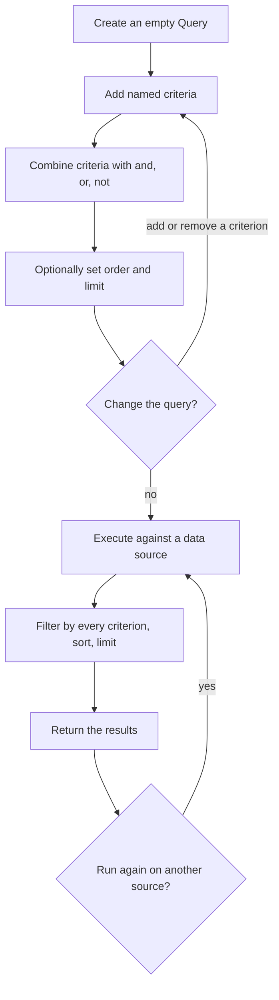
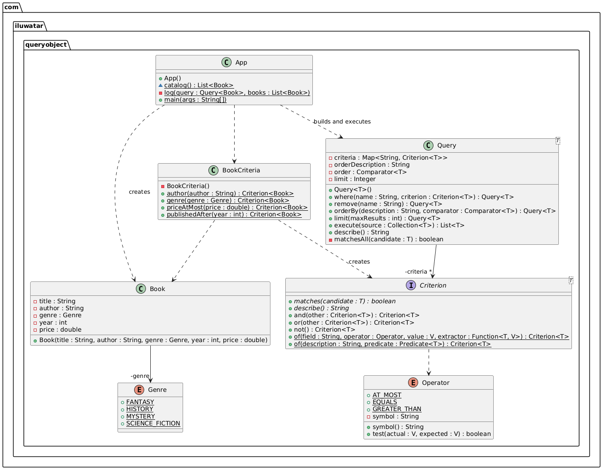

## Also known as

* Criteria Query
* Query Builder

## Intent of Query Object Design Pattern

Represent a query as an object, so that it can be built up step by step from criteria, changed later, described in the language of the data source and executed separately from its construction.

## Detailed Explanation of Query Object Pattern with Real-World Examples

Real-world example

> A library visitor fills in the search form of the catalog: genre is fantasy or science fiction, the price is at most 15 euros, sort by year. Seeing the results, they tick "published after 1960", then clear the price field and exclude one author. The form is the query object. The visitor changes it one field at a time, and the catalog only runs it when the search button is pressed. The same saved search can later be run against another library's catalog.

In plain words

> The Query Object pattern turns a query into an object made of criteria, so callers can compose and modify queries without writing a new finder method for every combination of conditions.

Martin Fowler says in Patterns of Enterprise Application Architecture

> An object that represents a database query.
>
> A Query Object is an interpreter, that is, a structure of objects that can form itself into a SQL query. You can create this query by referring to classes and fields rather than tables and columns.

Flowchart



Class diagram



## Programmatic Example of Query Object Pattern in Java

The example queries a small library catalog held in memory. No database is involved, so the focus stays on the pattern: building a query from criteria, changing it and executing it.

The domain object is a `Book`.

```java
public record Book(String title, String author, Genre genre, int year, double price) {}
```

A `Criterion` is one condition of a query. A leaf criterion is built from structured data: a field, an `Operator` and a value. Both its check and its SQL-like description come from that one source, so they cannot disagree, and the description is where a real query object would generate SQL. Criteria combine with `and`, `or` and `not` into larger criteria.

```java
public enum Operator {
  EQUALS("="),
  GREATER_THAN(">"),
  AT_MOST("<=");

  private final String symbol;

  // constructor and symbol() getter omitted

  public <V extends Comparable<? super V>> boolean test(V actual, V expected) {
    var comparison = actual.compareTo(expected);
    return switch (this) {
      case EQUALS -> comparison == 0;
      case GREATER_THAN -> comparison > 0;
      case AT_MOST -> comparison <= 0;
    };
  }
}
```

```java
public interface Criterion<T> {

  boolean matches(T candidate);

  String describe();

  static <T, V extends Comparable<? super V>> Criterion<T> of(
      String field, Operator operator, V value, Function<T, V> extractor) {
    var literal = value instanceof String ? "'" + value + "'" : String.valueOf(value);
    return of(
        field + " " + operator.symbol() + " " + literal,
        candidate -> operator.test(extractor.apply(candidate), value));
  }

  static <T> Criterion<T> of(String description, Predicate<T> predicate) {
    return new Criterion<>() {
      @Override
      public boolean matches(T candidate) {
        return predicate.test(candidate);
      }

      @Override
      public String describe() {
        return description;
      }
    };
  }

  default Criterion<T> and(Criterion<T> other) {
    return of(
        "(" + describe() + " AND " + other.describe() + ")",
        candidate -> matches(candidate) && other.matches(candidate));
  }

  default Criterion<T> or(Criterion<T> other) {
    return of(
        "(" + describe() + " OR " + other.describe() + ")",
        candidate -> matches(candidate) || other.matches(candidate));
  }

  default Criterion<T> not() {
    return of("NOT " + describe(), candidate -> !matches(candidate));
  }
}
```

`BookCriteria` offers the criteria callers can use, so they refer to the fields of `Book` and never to how the data is stored.

```java
public final class BookCriteria {

  public static Criterion<Book> genre(Genre genre) {
    return Criterion.of("genre", Operator.EQUALS, genre, Book::genre);
  }

  public static Criterion<Book> author(String author) {
    return Criterion.of("author", Operator.EQUALS, author, Book::author);
  }

  public static Criterion<Book> publishedAfter(int year) {
    return Criterion.of("year", Operator.GREATER_THAN, year, Book::year);
  }

  public static Criterion<Book> priceAtMost(double price) {
    return Criterion.of("price", Operator.AT_MOST, price, Book::price);
  }
}
```

The `Query` itself holds its criteria by name, so each one can be replaced or removed later. All criteria must match. Building the query and running it are separate steps: `execute` runs it against whatever source it is given and leaves the source unchanged.

```java
public class Query<T> {

  private final Map<String, Criterion<T>> criteria = new LinkedHashMap<>();
  private String orderDescription;
  private Comparator<T> order;
  private Integer limit;

  public Query<T> where(String name, Criterion<T> criterion) {
    criteria.put(name, criterion);
    return this;
  }

  public Query<T> remove(String name) {
    criteria.remove(name);
    return this;
  }

  public Query<T> orderBy(String description, Comparator<T> comparator) {
    this.orderDescription = description;
    this.order = comparator;
    return this;
  }

  public Query<T> limit(int maxResults) {
    if (maxResults < 0) {
      throw new IllegalArgumentException("limit must not be negative: " + maxResults);
    }
    this.limit = maxResults;
    return this;
  }

  public List<T> execute(Collection<T> source) {
    var results = source.stream().filter(this::matchesAll);
    if (order != null) {
      results = results.sorted(order);
    }
    if (limit != null) {
      results = results.limit(limit);
    }
    return results.toList();
  }

  public String describe() {
    var description = new StringBuilder("SELECT *");
    if (!criteria.isEmpty()) {
      description
          .append(" WHERE ")
          .append(
              criteria.values().stream()
                  .map(Criterion::describe)
                  .collect(Collectors.joining(" AND ")));
    }
    Optional.ofNullable(orderDescription)
        .ifPresent(o -> description.append(" ORDER BY ").append(o));
    Optional.ofNullable(limit).ifPresent(l -> description.append(" LIMIT ").append(l));
    return description.toString();
  }

  private boolean matchesAll(T candidate) {
    return criteria.values().stream().allMatch(criterion -> criterion.matches(candidate));
  }
}
```

The `App` builds a query, changes it twice and then reuses it on a second catalog.

```java
public static void main(String[] args) {
  var catalog = catalog();

  var query =
      new Query<Book>()
          .where("genre", genre(Genre.FANTASY).or(genre(Genre.SCIENCE_FICTION)))
          .where("price", priceAtMost(15.0))
          .orderBy("year", Comparator.comparingInt(Book::year));
  log(query, catalog);

  query.where("recent", publishedAfter(1960));
  log(query, catalog);

  query.remove("price").where("author", author("Ursula K. Le Guin").not()).limit(2);
  log(query, catalog);

  var secondHandShop =
      List.of(
          new Book("Foundation", "Isaac Asimov", Genre.SCIENCE_FICTION, 1951, 4.0),
          new Book("Neuromancer", "William Gibson", Genre.SCIENCE_FICTION, 1984, 6.0),
          new Book("The Colour of Magic", "Terry Pratchett", Genre.FANTASY, 1983, 3.5));
  LOGGER.info("Same query against another catalog:");
  log(query, secondHandShop);
}
```

Program output:

```
SELECT * WHERE (genre = FANTASY OR genre = SCIENCE_FICTION) AND price <= 15.0 ORDER BY year
  The Hobbit (1937)
  Dune (1965)
  A Wizard of Earthsea (1968)
SELECT * WHERE (genre = FANTASY OR genre = SCIENCE_FICTION) AND price <= 15.0 AND year > 1960 ORDER BY year
  Dune (1965)
  A Wizard of Earthsea (1968)
SELECT * WHERE (genre = FANTASY OR genre = SCIENCE_FICTION) AND year > 1960 AND NOT author = 'Ursula K. Le Guin' ORDER BY year LIMIT 2
  Dune (1965)
  Hyperion (1989)
Same query against another catalog:
SELECT * WHERE (genre = FANTASY OR genre = SCIENCE_FICTION) AND year > 1960 AND NOT author = 'Ursula K. Le Guin' ORDER BY year LIMIT 2
  The Colour of Magic (1983)
  Neuromancer (1984)
```

## When to Use the Query Object Pattern in Java

* Callers need ad hoc queries whose conditions vary, and a finder method for every combination would multiply.
* Queries are built step by step, for example from a search form or a filter panel, and change as the user refines them.
* The same query should run against different sources, or be translated into the language of a data source such as SQL.
* Callers should express queries in terms of the domain model instead of tables, columns or storage details.

## Real-World Applications of Query Object Pattern in Java

* The JPA Criteria API (`CriteriaBuilder`, `CriteriaQuery`) builds type-safe queries from objects.
* Hibernate's legacy `Criteria` API with `Restrictions.and`, `or` and `not`.
* Spring Data JPA `Specification` and Querydsl predicates passed to repositories.
* jOOQ builds SQL statements as Java objects before executing them.
* Search APIs such as the Elasticsearch Java client's `BoolQuery`, which combines `must`, `should` and `mustNot` clauses.

## Benefits and Trade-offs of Query Object Pattern

Benefits:

* Queries can be built, changed and reused at runtime without new finder methods.
* Callers work with domain fields, and the knowledge of how to query the data source stays in one place.
* Construction is separate from execution, so a query can be passed around, inspected or logged before it runs.
* Criteria are small, testable objects that combine freely.

Trade-offs:

* A general query object is a small interpreter; supporting every feature of the underlying query language is a lot of work, so most implementations cover only what the application needs.
* An extra layer of objects is overkill when the application has only a few fixed queries.
* Filtering in memory, as in this example, does not scale to large data sets; a real implementation translates the query so the data source does the filtering.

## Related Java Design Patterns

* [Specification](../specification): encapsulates one business rule that can be combined with others; a query object is often built from such criteria. Query Object adds named criteria that can be replaced or removed, ordering and limits, a translation into the language of the data source, and execution kept separate from construction.
* [Interpreter](../interpreter): a query object is an interpreter that forms itself into the language of the data source.
* [Composite](../composite): combined criteria form a tree that is evaluated as a single criterion.
* [Repository](../repository): repositories commonly accept query objects to find domain objects.
* [Data Mapper](../data-mapper): query objects use the mapping metadata to translate domain fields into storage.
* [Fluent Interface](../fluent-interface): the chained `where`, `orderBy` and `limit` calls make queries read naturally.

## References and Credits

* [Query Object (Martin Fowler)](https://martinfowler.com/eaaCatalog/queryObject.html)
* [Patterns of Enterprise Application Architecture (Martin Fowler, page 303)](https://books.google.fi/books?id=vqTfNFDzzdIC&pg=PA303#v=onepage&q&f=false)
* [Query Object Pattern (Hojjat's Blog)](https://www.hojjatk.com/2018/08/query-object-pattern.html)
