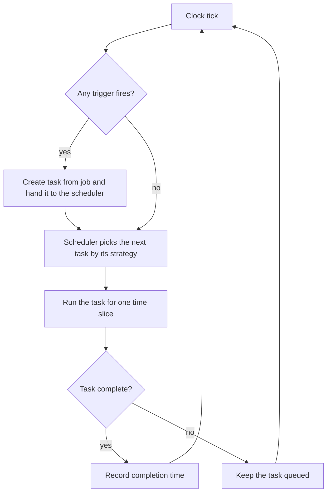
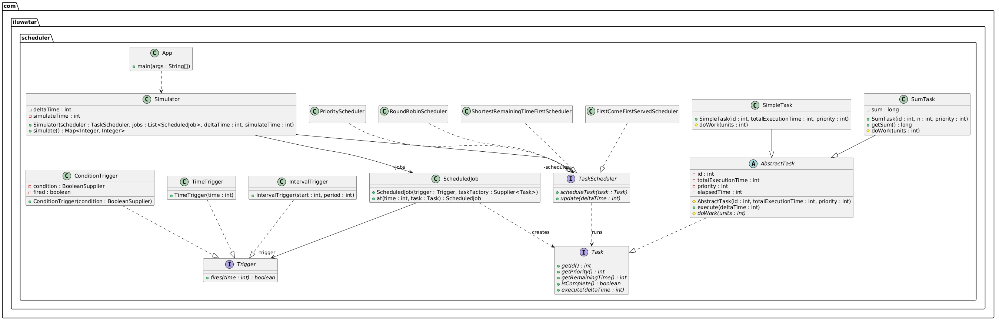

## Also known as

* Job Scheduler
* Task Scheduler

## Intent of Scheduler Design Pattern

Manage the execution of tasks that compete for a limited resource. The pattern keeps three concerns apart: the task that holds the work, the trigger that decides when a task becomes ready, and the scheduler that decides which ready task runs next and for how long.

## Detailed Explanation of Scheduler Pattern with Real-World Examples

Real-world example

> A restaurant kitchen has one chef and many orders. Orders arrive when guests sit down (a fixed time), the bread is baked every morning (an interval), and the dessert is plated only once the main course has left the kitchen (a condition). The head chef does not cook any of them; they decide which order the cook works on next, whether that is the oldest order, the VIP table, a few minutes on each dish in turn, or the dish that is nearly done.

In plain words

> The Scheduler pattern decides which piece of work runs next, so the work itself does not have to know about timing or about the other work waiting for the same resource.

Wikipedia says

> In computing, scheduling is the action of assigning resources to perform tasks. The resources may be processors, network links or expansion cards. The tasks may be threads, processes or data flows. The scheduling activity is carried out by a mechanism called a scheduler.

Flowchart





## Programmatic Example of Scheduler Pattern in Java

The example models a single worker that runs tasks in time slices, the way an operating system shares one CPU between processes. It has four parts, matching the elements of the pattern.

**Task.** A `Task` is the unit of work. The scheduler only needs to know its id, its priority, how much time it still needs and whether it is done.

```java
public interface Task {
  int getId();
  int getPriority();
  int getRemainingTime();
  boolean isComplete();
  void execute(int deltaTime);
}
```

`AbstractTask` keeps the time accounting, so a concrete task only implements the work done in one slice. `SimpleTask` only reports its progress, while `SumTask` computes `1 + 2 + ... + n` one number per time unit, so its work can be paused and resumed between slices.

```java
public abstract class AbstractTask implements Task {
  // id, totalExecutionTime, priority and elapsedTime fields

  @Override
  public void execute(int deltaTime) {
    if (isComplete()) {
      throw new IllegalStateException("Task " + id + " is already complete");
    }
    var units = Math.min(deltaTime, getRemainingTime());
    doWork(units);
    elapsedTime += units;
  }

  protected abstract void doWork(int units);
}

public class SumTask extends AbstractTask {
  @Getter private long sum;
  private int next = 1;

  @Override
  protected void doWork(int units) {
    for (var i = 0; i < units; i++) {
      sum += next++;
    }
  }
}
```

**Trigger.** A `Trigger` decides when a job hands a new task to the scheduler. `TimeTrigger` fires once at a fixed time, `IntervalTrigger` fires repeatedly like a cron job, and `ConditionTrigger` fires once, the first time a condition becomes true.

```java
public interface Trigger {
  boolean fires(int time);
}

public record IntervalTrigger(int start, int period) implements Trigger {
  @Override
  public boolean fires(int time) {
    return time >= start && (time - start) % period == 0;
  }
}
```

A `ScheduledJob` pairs a trigger with a task factory. The factory is needed because a repeating trigger must create a fresh task each time it fires.

```java
public record ScheduledJob(Trigger trigger, Supplier<Task> taskFactory) {
  public static ScheduledJob at(int time, Task task) {
    return new ScheduledJob(new TimeTrigger(time), () -> task);
  }
}
```

**Scheduler.** `TaskScheduler` is the strategy that decides which ready task runs next.

```java
public interface TaskScheduler {
  void scheduleTask(Task task);
  void update(int deltaTime);
}
```

There are four implementations:

* `FirstComeFirstServedScheduler` runs each task to completion in arrival order.
* `PriorityScheduler` always runs the task with the highest priority, so an arriving high-priority task preempts the running one.
* `RoundRobinScheduler` gives every task one time slice in turn.
* `ShortestRemainingTimeFirstScheduler` runs the task closest to completion.

```java
public class RoundRobinScheduler implements TaskScheduler {
  private final Queue<Task> taskQueue = new ArrayDeque<>();

  @Override
  public void scheduleTask(Task task) {
    taskQueue.add(task);
  }

  @Override
  public void update(int deltaTime) {
    var task = taskQueue.poll();
    if (task == null) {
      return;
    }
    task.execute(deltaTime);
    if (!task.isComplete()) {
      taskQueue.add(task);
    }
  }
}
```

**Execution context.** The `Simulator` advances a clock, fires the triggers, hands new tasks to the scheduler, lets the scheduler run one slice and records when each task completes.

```java
public Map<Integer, Integer> simulate() {
  Map<Integer, Integer> completedAt = new LinkedHashMap<>();
  List<Task> running = new ArrayList<>();
  for (var time = 0; time < simulateTime; time += deltaTime) {
    for (var job : jobs) {
      if (job.trigger().fires(time)) {
        var task = job.taskFactory().get();
        running.add(task);
        scheduler.scheduleTask(task);
      }
    }
    scheduler.update(deltaTime);
    // record and drop the tasks that completed in this slice
  }
  return completedAt;
}
```

`App` runs one workload through every scheduler. The workload uses all three trigger types: a backup (task 1) and a sum (task 2) arrive at fixed times, a report (tasks 101 and up) repeats every 10 time units, and a cleanup (task 3) starts only once the backup is complete.

```java
static List<ScheduledJob> workload() {
  var backup = new SimpleTask(1, 5, 1);
  var reportIds = new AtomicInteger(100);
  return List.of(
      ScheduledJob.at(0, backup),
      ScheduledJob.at(1, new SumTask(2, 4, 3)),
      new ScheduledJob(
          new IntervalTrigger(2, 10), () -> new SimpleTask(reportIds.incrementAndGet(), 2, 2)),
      new ScheduledJob(new ConditionTrigger(backup::isComplete), () -> new SimpleTask(3, 3)));
}

public static void main(String[] args) {
  List<TaskScheduler> schedulers =
      List.of(
          new FirstComeFirstServedScheduler(),
          new PriorityScheduler(),
          new RoundRobinScheduler(),
          new ShortestRemainingTimeFirstScheduler());
  for (var scheduler : schedulers) {
    var completedAt = new Simulator(scheduler, workload(), 1, 30).simulate();
    LOGGER.info("{} completed tasks at: {}", scheduler.getClass().getSimpleName(), completedAt);
  }
}
```

The same tasks finish in a different order under each strategy. Each entry maps a task id to the time it completed:

```
FirstComeFirstServedScheduler completed tasks at: {1=5, 2=9, 101=11, 3=14, 102=16, 103=24}
PriorityScheduler completed tasks at: {2=5, 101=7, 1=11, 102=14, 3=16, 103=24}
RoundRobinScheduler completed tasks at: {101=8, 1=10, 2=11, 3=15, 102=16, 103=24}
ShortestRemainingTimeFirstScheduler completed tasks at: {101=4, 1=7, 3=10, 2=14, 102=16, 103=24}
```

## When to Use the Scheduler Pattern in Java

* Many tasks compete for a limited resource, such as a thread, a CPU, a connection or a device, and the order in which they run matters.
* Work must start at a given time, repeat on an interval, or wait for an event or for other work to finish.
* The scheduling policy should be changeable without touching the tasks, for example to favour throughput, fairness, latency or business priority.

## Real-World Applications of Scheduler Pattern in Java

* `java.util.concurrent.ScheduledExecutorService` runs tasks after a delay or at a fixed rate.
* [Quartz Scheduler](https://www.quartz-scheduler.org/) separates `Job`, `Trigger` and `Scheduler` in the same way as this example.
* Spring's `@Scheduled` and `TaskScheduler` run methods on cron expressions, fixed rates or fixed delays.
* `ForkJoinPool` and the virtual-thread scheduler of the JVM decide which runnable task gets a carrier thread next.
* Operating system process schedulers use the FCFS, priority, round robin and shortest-remaining-time-first policies shown here.

## Benefits and Trade-offs of Scheduler Pattern

Benefits:

* Tasks, triggers and scheduling policies vary independently, so a new policy or a new kind of task needs no change elsewhere.
* Centralises the decision about which work runs, which makes resource usage predictable and easy to tune.
* Supports time-based, periodic and event-driven work through one mechanism.

Trade-offs:

* Every policy favours something: FCFS lets a long task block short ones, priority scheduling can starve low-priority tasks, round robin adds switching overhead and SRTF needs to know how long a task will take.
* Preemption requires tasks that can stop and resume safely between time slices.
* The scheduler is a central component; if it is slow or fails, all scheduled work is affected.

## Related Java Design Patterns

* [Strategy](../strategy): each scheduling policy is a strategy behind the `TaskScheduler` interface.
* [Command](../command): a task encapsulates a request so that it can be queued and run later.
* [Thread Pool Executor](../thread-pool-executor): a pool of worker threads is the resource a scheduler often hands tasks to.
* [Producer-Consumer](../producer-consumer): triggers produce tasks and the scheduler consumes them.
* [Game Loop](../game-loop): advances a clock and updates the world each tick, much like the simulator here.

## References and Credits

* [Scheduling (computing) (Wikipedia)](https://en.wikipedia.org/wiki/Scheduling_(computing))
* [Operating Systems: Three Easy Pieces, chapters on scheduling (Remzi and Andrea Arpaci-Dusseau)](https://pages.cs.wisc.edu/~remzi/OSTEP/)
* [Quartz Scheduler documentation](https://www.quartz-scheduler.org/documentation/)
* [ScheduledExecutorService (Java SE 21 API)](https://docs.oracle.com/en/java/javase/21/docs/api/java.base/java/util/concurrent/ScheduledExecutorService.html)
